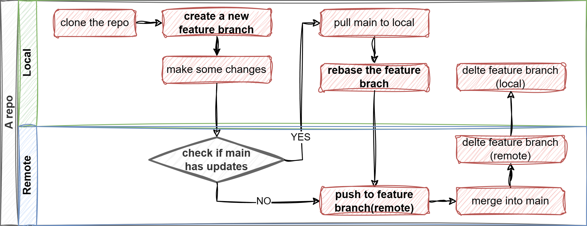

Git is an essential tool for software developers, enabling efficient collaboration and robust version control. This post explains a basic workflow and the use of feature branches and rebasing to streamline development processes, ensuring that projects remain organized and scalable.


_A simple and safe workflow_

### Feature Branches: Strategic Isolation

**Feature branches** serve as dedicated environments for specific features or bug fixes, separate from the main codebase. This strategy has multiple advantages:

- **Isolates Changes**: By working in isolated branches, developers can experiment and develop without risking the stability of the main branch. This isolation is crucial, especially when multiple features are being developed simultaneously.
- **Facilitates Reviews**: It simplifies the code review process. Reviewers can focus on the changes relevant to a specific feature, making the review process more efficient and thorough.

### Rebasing: Streamlining Project History

**Rebasing** is a powerful alternative to merging that integrates changes by reapplying commits on top of another base tip. This approach enhances the development workflow by:

- **Maintaining a Linear History**: Rebasing rewrites the commit history to create a clean, straightforward progression of events. This linear history is not only easier to understand but also simplifies the process of locating and addressing bugs.
- **Reducing Clutter**: Unlike merging, which adds a new commit every time you integrate changes, rebasing rewrites the project history without extra merge commits. This keeps the commit log concise and easy to navigate.

### Integrated Git Workflow: A Step-by-Step Guide

Here’s a detailed guide on incorporating feature branches and rebasing into your Git workflow:

#### 1. **Clone the Repository**

```bash
git clone url  # Clones the project to your local machine.
```

#### 2. **Create and Switch to a Feature Branch**

```bash
git checkout -b feature-branch-name  # Creates and switches to your new branch.
```

This command starts off a new branch, ensuring that any changes made are kept separate from the main branch until they're ready to be reviewed and merged.

#### 3. **Develop and Stage Changes**

```bash
git add <changed-files>  # Stages changes for commit.
git commit -m "your commit message"  # Records your changes in Git.
```

Regular commits help track progress and create restore points, which can be crucial for undoing changes if needed.

#### 4. **If main branch is updated by others, Update your _LOCAL_ main branch, and _REBASE_ your feature branch**

```bash
git checkout main
git pull origin main  # Updates main with the latest changes from the remote.
git checkout feature-branch-name
git rebase main  # Rebases current branch off of main.
```

Keeping your branch updated minimizes integration issues later. Rebasing here ensures your feature can easily merge back into main later without complex conflicts.

#### 5. **Resolve Conflicts if Necessary**

```bash
git add <resolved-files>
git rebase --continue
```

If conflicts arise during rebase, resolving them immediately keeps your branch clean and ready for eventual merging.

#### 6. **Push Changes to remote and Prepare for Merge**

```bash
git push -f origin feature-branch-name  # Force-push your rebased branch.
```

Force-pushing is necessary after a rebase because it changes the commit history. This step ensures that the remote branch aligns with your local changes.

#### 7. **Create a Pull Request**

This is the stage where team collaboration comes into play. The pull request initiates discussions about the changes, allows for code reviews, and acts as the final checkpoint before merging.

#### 8. **Finalize and Clean Up**

```bash
git checkout main
git pull origin main  # Ensure local main is up-to-date.
git branch -D feature-branch-name  # Deletes the local feature branch.
```

Cleaning up after your branch has been merged keeps the repository tidy and focused only on active developments.

### Conclusion

Using feature branches and rebasing in Git not only optimizes the development process but also contributes to a well-organized, accessible codebase. These strategies enable developers to work concurrently on diverse features without interference, streamline the history for easier troubleshooting, and simplify the integration of new features. By embedding these practices into your workflow, you enhance both productivity and the quality of the software you develop.

### An overview

```bash
# clone the project
git clone url #the link of the project
git checkout -b feature-branch-name

# make some changes
git diff # check the differences you have made
git add < changed-files > # add your changed file in this commit
git commit -m "your commit message"
git push origin feature-branch-name # create a new feature branch in remote repo

# when a new update is added to main simultaneously, rebase your feature branch.
# when not, just merge into main directly
git checkout main # change to main branch
git pull origin main # pull the updates
git checkout feature-branch-name # change to my feature branch
git rebase main # use the new main as your base, may have conflict
git push -f origin feature-branch-name

# merge into main. New pull request, then Squash and merge

# delete feature branch remote and locally
git checkout main
git branch -D feature-branch-name
git pull origin main

# finish

```

### Reference this video


