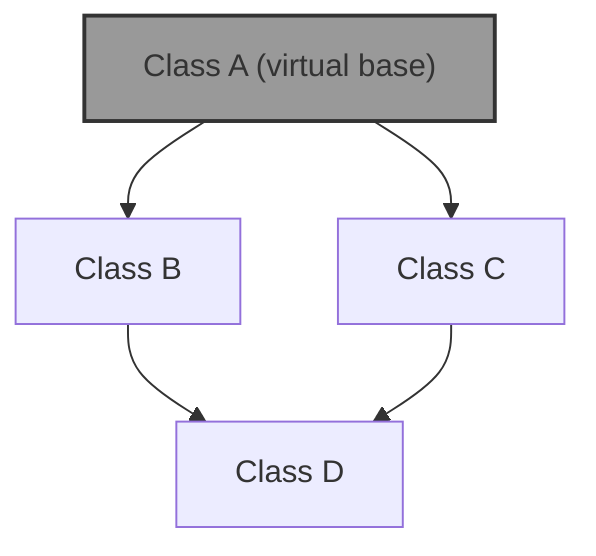
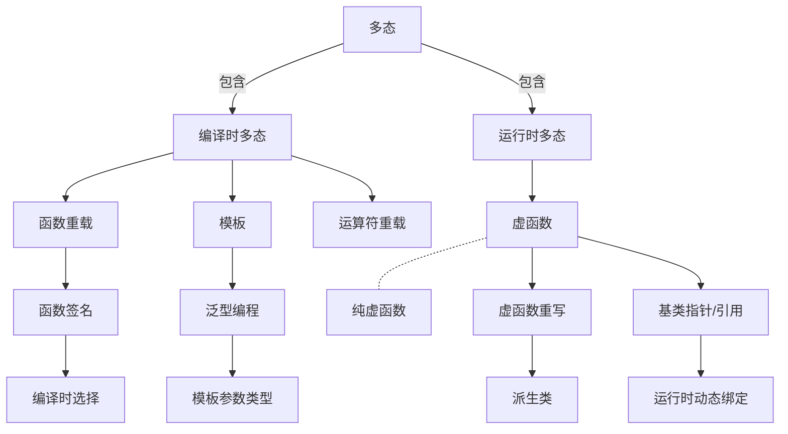

![[Pasted image 20240902134216.png]]

# C++ Content

## C++ 基本知识

### 1. 基本语法与语言特性

#### 数据类型

- **基本类型**：
  - `int`：整型，通常占 4 字节（取决于系统）。
  - `char`：字符型，通常占 1 字节。(char - char = int, 占 4 字节)
  - `long long`：长整型，通常占 8 字节。
  - `float`：单精度浮点型，通常占 4 字节。
  - `double`：双精度浮点型，通常占 8 字节。
  - `bool`：布尔类型，只能为 `true` 或 `false`。
  - 注意是否为有符号/无符号 `signed` `unsigned`
  - 浮点数不可以直接`==`比较，要设置一个`epsilon`作为标准
- **`sizeof` 运算符**：返回对象或类型的大小（以字节为单位），如 `sizeof(int)` 返回 4。
- **枚举类型 `enum`**：
  - 定义：`enum Color {RED, GREEN, BLUE};`。
  - 默认从 0 开始递增，`RED` = 0, `GREEN` = 1, `BLUE` = 2。
  - 可以指定值，如 `enum Color {RED = 1, GREEN, BLUE};`。
  - 任意赋值，自动递增
- **结构体 `struct`**：
  - 用于组合多个不同类型的数据成员。
  - 例：`struct Point {int x; int y;};`，`Point p1; p1.x = 10;`。
  - 注意**深拷贝函数的实现**，比如结构体里有`vector<int>`
- **联合体 `union`**：
  - 所有成员**共用一段内存**，节省空间。
  - 例：`union Data {int i; float f; char c;};`，存储不同类型的变量但只有一个能有效。写入一个，覆盖一个

#### 指针与引用

- **指针**：
  - 指针存储变量的地址的**一个变量**，如 `int *p = &a;`。
  - `*p` 解引用，访问指针指向的值。
  - 指针运算：如 `p + 1` 会跳过 `sizeof(type)` 个字节。
  - 指针本身 **不存储实际的变量类型信息**，而是通过指针的类型来 **控制如何解释该内存地址中的数据**。
- **空指针 `nullptr`**：表示指针不指向任何有效地址。
- **悬空指针**：指向已释放的内存区域，可能导致未定义行为。
- **引用**：
  - 本质是变量的别名，如 `int &ref = a;`。
  - 一旦初始化，不能再改变引用指向的对象。
- **指针与引用的区别**：
  - 引用必须在声明时初始化，指针可以随时指向不同的地址。
  - 引用不能为 `null`，指针可以为空。

如果 a 是数组，那么`int *p = a` 合法，指向第一个地址
如果 a 是`ListNode *`, 那么也合法，但如果是`int` 或是 `ListNode`，那么不合法

#### 数组与字符串

- **数组**：
  - 声明：`int arr[10];` 表示一个包含 10 个 `int` 元素的数组。
  - 数组的元素通过下标访问，如 `arr[0] = 1;`。
- **字符数组与字符串字面量**：
  - 字符数组：`char str[10] = "hello";`。
  - 字符串字面量：存储在静态内存中，不可修改，如 `const char* str = "hello";`。
- **`std::string`**：
  - 动态管理字符串的类，支持自动扩展、操作符重载（如 `+`, ` ==`），以及各种字符串操作函数，如 `str.length()`，`str.find("sub")`。

#### 函数

- **函数声明与定义**：
  - 声明：`int add(int, int);`
  - 定义：`int add(int a, int b) { return a + b; }`
  - 要在调用之前声明或定义
- **参数传递**：
  - 值传递：传递的是参数的副本，函数内修改不影响外部。
  - 指针传递：传递的是地址，可以修改原始数据。
  - 引用传递：传递的是变量的别名，函数内的修改会影响外部。
- **函数重载**：同名函数根据参数类型或数量不同有不同的实现，如 `void func(int); void func(double);`。
  - 函数重载仅仅通过不同的参数列表来区分函数，返回类型无法区分。
  - 函数重载是编译时的行为，编译器会根据函数签名（即函数名、参数类型、参数数量）来选择合适的重载函数。
- **内联函数 `inline` （一种优化技术）**：
  - 通过在函数前加 `inline` 提示编译器将函数嵌入到调用处，以减少跳转的函数调用开销。
  - 适用于频繁调用的小型函数，没有递归或复杂的控制流
  - 可能导致代码膨胀（体积增加），编译时间增加，编译器有最终的决定权，它可能会忽略 `inline` 关键字
- **默认参数**：如 `void func(int x = 10);` 可以在调用时省略参数。
  ![[C++  八股文（核心内容）#内联与宏定义]]

#### 作用域

- **局部变量与全局变量**：
  - 局部变量：在函数或代码块内声明，作用域仅限于该块内。
  - 全局变量：在所有函数外部声明，整个程序都能访问。
- **静态变量 `static`**：
  - 局部静态变量：声明于函数内，生命周期在程序结束后才销毁，函数多次调用保留其值。
  - 全局静态变量：限制其作用域在声明的文件内。
  - 对应有静态成员变量和静态成员函数：表示这个变量/函数属于类，而不是类的实例。所有对象共享。**静态成员函数只能访问静态成员变量和静态成员函数。**
  - `static` 和 `const` 可以一起使用。例如，在类中定义 **静态常量成员变量**
- **命名空间 `namespace`**：
  - 为程序中的标识符（如变量、函数、类等）提供了一个范围，标识符的容器
  - 避免命名冲突，将标识符放入命名空间中，如 `namespace myNamespace { int var; }`。也可以将函数模板或其他位置定义好的函数加入命名空间。
  - 使用时可通过 `myNamespace::var` 访问，或通过 `using namespace myNamespace;` 导入。
  - C++标准库中定义了大量常用的类、函数和模板，如输入输出流（cin、cout）、容器（vector、map）、算法（sort、find）等
  - 不推荐`using namespace xxx`, 可能导致冲突，可以使用`std::cout << "Hello, world!" << std::endl;`，或`using std::endl; cout << "Hello, world!" << std::endl;`, 引入需要的标识符
- 作用域解析运算符 `::`
  - 用于访问类、命名空间、枚举等的成员
  - `int MyClass::count = 10;`
  - `MyNamespace::printValue();`
  - 用于访问全局作用域的成员，局部相同标识符变量会遮蔽全局变量，使用`::value` 访问全局作用域中的 `value`

| **概念**     | **定义**                                                                           | **作用**                                         | **例子**                                       |
| ------------ | ---------------------------------------------------------------------------------- | ------------------------------------------------ | ---------------------------------------------- |
| **标识符**   | 用户自定义的名字，用于标识变量、函数、类等。                                       | 用于命名程序中的实体，并通过这些名字引用它们。   | `int myVariable;`                              |
| **关键字**   | C++ 语言中预定义的保留字，有特殊的意义，不能作为标识符。                           | 定义语言结构（如类型、控制流语句、函数声明等）。 | `int`、`if`、`else`、`return`等                |
| **命名空间** | 用于组织代码，防止标识符冲突。命名空间允许相同名称的标识符存在于不同的命名空间中。 | 将相关代码分组，避免标识符命名冲突。             | `namespace std {}`、`namespace MyNamespace {}` |

### 2. 面向对象编程

#### 类与对象

- **类的定义与声明**：
  - 定义：`class ClassName { public: int x; void func(); };`
  - 声明与实现分离：在 `.h` 文件中声明类，在 `.cpp` 文件中定义成员函数。
- **对象的创建**：`ClassName obj;` 使用默认构造函数创建对象。
- **构造函数与析构函数**：
  - 构造函数：在对象创建时自动调用，初始化对象，如 `ClassName() { x = 0; }`。
  - 析构函数：在对象销毁时自动调用，清理资源，如 `~ClassName() { delete ptr; }`。
- **拷贝构造函数**：
  - 用于创建一个对象的副本，如 `ClassName(const ClassName &other)`。
  - 默认行为是浅拷贝，如需深拷贝需自定义拷贝构造函数。
- **赋值操作符重载**：
  - 用于对象之间的赋值操作，如 `ClassName& operator=(const ClassName &other)`。
  - 注意自我赋值检查和释放已有资源。

#### 继承与多态

- **继承**：

```cpp
class 派生类名 : 继承方式 基类名 { // 派生类新增的成员 };
```

- 公有继承：`class Derived : public Base { };`，基类的公有成员在派生类中保持公有。
- 私有继承：`class Derived : private Base { };`，基类的所有成员在派生类中变为私有。
- 保护继承：`class Derived : protected Base { };`，基类的公有和保护成员在派生类中变为保护。
- **基类与派生类**：
  - 派生类继承基类的成员函数和数据成员，可以增加新的成员或重写基类的虚函数。
  - 声明基类指针可以指向派生类，也可以通过虚函数调用对应派生类的实现。
    - 例如 `Animal * animal = new Dog();`
    - 可以增强代码的通用性和扩展性，在增加派生类时也不需要修改代码
- **虚函数与纯虚函数 （virtual function）**：
  > [!INFO]
  >
  > - 虚函数：基类中使用 `virtual` 关键字声明，目的是允许派生类重写，以**实现运行时多态**。
  > - 纯虚函数：声明但不定义，格式为 `virtual void func() = 0;`，使得类成为抽象类。
  > - 不可以内联[[C++  八股文（核心内容）#内联与宏定义]]
  > - 虚函数的作用：
  >   - **多态性：** 通过基类指针或引用调用不同子类的虚函数，实现多态。
  >   - **动态绑定：** 虚函数的调用在运行时确定，而不是在编译期，实现了动态绑定。
  >   - **抽象基类：** 纯虚函数（在声明虚函数时赋值为 0）可以定义抽象基类，抽象基类**不能实例化**，只能被继承。
  > - **动态绑定与多态**：
  >   - 基类指针或引用指向派生类对象时，通过虚函数实现动态绑定，调用派生类的函数。
  > - **虚函数的开销：** 虚函数调用比普通函数调用开销更大，因为涉及到虚函数表的查找。
  > - **虚析构函数**：若类有虚函数，析构函数应定义为虚函数，以确保删除派生类对象时调用正确的析构函数。
- **继承中的构造函数与析构函数调用顺序**：
  - 构造函数：基类构造函数先执行，后执行派生类的构造函数。
  - 析构函数：派生类析构函数先执行，后执行基类的析构函数。

**虚基类与菱形继承**



- 虚基类通过确保基类的成员在继承链中只会初始化一次来解决这个问题。使用虚继承的类会确保只有一个 `A` 类的副本，而不管它被多少个中间类（如 `B` 和 `C`）继承。
- 使用虚继承时，可以通过关键字 `virtual` 来标明基类是虚基类

```cpp
class A {
public:
    A() { cout << "A's constructor\n"; }
};
class B : virtual public A {
public:
    B() { cout << "B's constructor\n"; }
};
class C : virtual public A {
public:
    C() { cout << "C's constructor\n"; }
};
class D : public B, public C {
public:
    D() { cout << "D's constructor\n"; }
};
```

- 当派生类的对象被创建时，构造函数的调用顺序如下：
  1.  **非虚基类**：首先调用**最基类的**非虚基类构造函数，按照它们在继承列表中的顺序。也就是说，在派生类的构造函数执行之前，所有非虚基类的构造函数都会先被调用。
  2.  **虚基类**：如果有虚基类，它们的构造函数会在所有非虚基类之后被调用，并且只会调用一次（最派生类负责调用），无论它在继承链中的位置如何。
  3.  **派生类**：最后调用派生类本身的构造函数。

#### 访问控制

- **`public`**：公有成员可以被任意访问。
- **`protected`**：保护成员只能被类自身、**友元**、派生类访问。
- **`private`**：私有成员只能被类自身和友元访问。
- **友元函数与友元类**：
  - 友元函数：使用 `friend` 关键字声明，能够访问类的私有和保护成员。
  - 友元类：声明为友元类的所有成员函数可以访问另一个类的私有和保护成员。
  - 可以实现多个类之间的数据共享

#### 运算符重载

- **重载运算符**：通过在类中定义运算符函数来重载标准运算符，如 `operator+`。
  - 如重载 `+` 运算符：`ClassName operator+(const ClassName &other);`
  - 注意需要**重载赋值运算符** `operator=` 以防止浅拷贝。
- **重载常见运算符**：
  - 算术运算符：`+`, `-`, `*`, `/`。
  - 关系运算符：` ==`, `!=`, `<`, `>`。
  - 访问运算符：`[]`, `->`, `*`, `()`。
- **C++值类别**：
  - 左值：可以取地址的对象或内存位置
  - 右值（纯右值&将亡值）：不可直接赋值，不可寻址，例如：_函数的返回值（非引用返回）、字面量、临时对象_
  - 右值引用：实现**移动语义**和完美转发

| 特点     | 左值引用                 | 右值引用                 |
| -------- | ------------------------ | ------------------------ |
| 表示     | 可以多次访问的持久对象   | 临时对象或即将销毁的对象 |
| 可寻址性 | 可以取地址               | 不能取地址               |
| 可赋值性 | 可以出现在赋值语句的左边 | 不能出现在赋值语句的左边 |
| 绑定对象 | 左值                     | 右值                     |
| 主要用途 | 一般用于修改对象         | 用于移动语义和完美转发   |

[[C++  八股文（核心内容）#右值引用与移动语义]]

### 3. 模板与泛型编程

#### 函数模板与类模板

- **函数模板**：
  - 用于创建泛型函数，使函数可以接受任意类型的参数。
  - 使用时，编译器会根据传入的参数类型自动推导模板参数。
  - 可以显式指定类型：`add<int>(3, 5);`，或者隐式推导：`add(3, 5);`。
- **类模板**：
  - 用于创建泛型类，使类可以处理任意类型的数据。
  - 类模板实例化时，需指定类型：`MyClass<int> obj(10);`。
  - 模板参数可以有默认值：`template <typename T = int> class MyClass { ... };`。
- 语法：

```cpp
template <typename T>
T add(T a, T b) {
	return a + b; }

template <typename T>
class Array {
public:
	Array(int size) : size_(size) {
		ptr_ = new T[size];
	}
};
```

- **模板特化**：
  - 全特化：为某一特定类型提供专门的实现。
  - 语法：

```cpp
template <>
class MyClass<int> {
/* specialized implementation */ };
```

- 偏特化：是指针对模板参数的**某一部分**进行定制。与全特化不同，偏特化允许我们在保留部分模板参数的情况下，为某些特定的类型组合提供实现。
- 语法：

```cpp
// 偏特化：当两个参数都是指针类型时，提供不同的实现
template <typename T>
T* add(T* a, T* b) {
	return *a + *b; } // 对指针类型进行处理
```

#### 多态

- 所谓编译时多态，是指编译器在编译时根据函数调用的上下文（如参数类型、数量、顺序）决定调用哪个版本的函数。
- 运行时多态是指，在程序运行时，函数的具体实现由程序的实际对象类型决定。虚函数通过 **动态绑定** 实现多态，即函数的调用会在运行时动态决定。
- 动态绑定 与 静态绑定：
  - **静态绑定**（Static Binding）：指的是在编译时，编译器确定函数调用的目标。对于普通的函数调用、非虚函数的调用，或者函数重载等，编译器在编译时就确定了调用的函数版本，这就是静态绑定。
  - **动态绑定**（Dynamic Binding）：指的是在 **运行时**，根据对象的实际类型（而不是声明类型）来决定调用哪个函数版本。这是 **运行时多态** 的基础，是通过虚函数和虚函数表（vtable）来实现的
- **虚函数的工作原理**：
  - 虚函数是在基类中声明为 `virtual` 的函数，它允许派生类重写该函数。
  - 当通过基类指针或引用调用虚函数时，C++ 会根据 **实际对象类型**（即对象的动态类型）来决定调用哪个函数版本。这是通过虚函数表（vtable）实现的，它存储了指向类中虚函数的指针。
  - 虚函数的选择是在 **运行时** 由对象的实际类型（而不是声明类型）来决定的，因此它属于 **运行时多态**。
  - C++ 允许基类指针或引用指向派生类对象，**通过基类指针或引用来访问派生类的成员**，调用哪个函数的实现是 **运行时** 决定的 而 非编译时决定的



#### STL 容器与算法

- **常用容器**：
  - `std::vector`：动态数组，支持随机访问，自动扩展容量。
  - `std::list`：双向链表，支持高效的插入和删除操作，不支持随机访问。
  - `std::deque`：双端队列，支持快速在头尾插入和删除元素，支持随机访问。双端数组实现。
  - `std::map`：键值对存储，有序映射，基于红黑树实现。
  - `std::unordered_map`：无序映射，基于哈希表实现。
  - `std::set`：有序集合，不允许重复元素，基于红黑树实现。
  - `std::unordered_set`：无序集合，不允许重复元素，基于哈希表实现。
- 容器适配器：
  - `stack`
  - `queue`
  - `priority_queue`
- **迭代器**：
  - `std::vector<int>::iterator it = vec.begin();` 通过迭代器访问容器元素。
  - 常见的迭代器种类：`input_iterator`, `output_iterator`, `forward_iterator`, `bidirectional_iterator`, `random_access_iterator`。
- **常用算法**：
  - `std::sort`：对范围内的元素进行排序。
  - `std::find`：查找元素，返回指向找到的元素的迭代器或 `end()`。
  - `std::copy`：将一个范围内的元素复制到另一个范围。
  - `std::for_each`：对范围内的每个元素应用给定的函数。

```cpp
#include <algorithm>
#include <vector>
template <class InputIterator, class Function>
Function for_each (InputIterator first, InputIterator last, Function fn);

std::vector<int> numbers = {1, 2, 3, 4, 5};
std::for_each(numbers.begin(), numbers.end(), [](int num) {
    // 对每个元素 num 执行的操作
    std::cout << num * 2 << " ";
});
```

> [!TIP]
>
> - **`for_each` 函数:**
>   - `numbers.begin()`: 容器的起始迭代器。
>   - `numbers.end()`: 容器的结束迭代器（指向最后一个元素的下一个位置）。
>   - `[](int num) { ... }`: 一个 lambda 表达式，它接受一个 `int` 类型的参数 `num`，并对 `num` 进行操作。
> - **lambda 表达式:**
>   - `[]`: 捕获列表，用于指定 lambda 表达式可以访问的外部变量。
>   - `(int num)`: 参数列表，表示 lambda 表达式接受一个 `int` 类型的参数。
>   - `{ ... }`: 函数体，包含对参数 `num` 的操作。

### 4. 异常处理

#### 异常机制

- **基本语法**：
  - `try` 块：放置可能引发异常的代码。
  - `throw` 语句：用于抛出异常，`throw -1;` 或 `throw std::runtime_error("Error!");`。
  - `catch` 块：捕获异常并处理，`catch (int e) { /* handle int exception */ }`。
- **标准异常类**：
  - C++ 标准库提供了一系列异常类，如 `std::exception` 是所有标准异常类的基类。
  - 常用的派生类包括：
    - `std::runtime_error`：运行时错误。
    - `std::logic_error`：逻辑错误。
    - `std::bad_alloc`：内存分配失败异常。
- **自定义异常类**：
  - 可以继承 `std::exception` 或其他标准异常类来自定义异常。
  - 例：`class MyException : public std::exception { const char* what() const throw() { return "My custom exception"; } };`
- **异常安全性**：
  - 异常安全代码应确保即使在异常发生时，程序状态仍然保持一致。
  - 基本保证：即使发生异常，也不会发生资源泄漏。
  - 强保证：要么操作完全成功，要么恢复到操作前的状态。
  - `nothrow` 保证：承诺函数不会抛出任何异常（通过 `noexcept` 关键字）。

### 5. 内存管理

#### 动态内存分配

- **`new` 与 `delete`**：
  - `new`：动态分配内存并调用构造函数，`int* p = new int(10);`。
  - `delete`：释放通过 `new` 分配的内存并调用析构函数，`delete p;`。
  - `new[]` 和 `delete[]`：用于数组的动态分配和释放，`int* arr = new int[10]; delete[] arr;`。
- **`malloc` 与 `free`**：
  - `malloc`：C 标准库函数，用于动态分配内存，`void* p = malloc(10 * sizeof(int));`。
  - `free`：释放由 `malloc` 分配的内存，`free(p);`。
  - `new` 和 `delete` 与 `malloc` 和 `free` 的区别：
    - `new` 和 `delete` 是运算符，会调用构造函数和析构函数。
    - `malloc` 和 `free` 是函数，不会调用构造函数和析构函数。
- **内存泄漏**：
  - 由于未正确释放动态分配的内存而导致的内存无法再使用。
  - 常见于没有 `delete` 对应的 `new`，或循环、异常处理中的误用。

[[操作系统内存分配与C++内存管理]]

#### 对象的生命周期

- **生命周期阶段**：
  - 创建：对象的内存被分配并调用构造函数。
  - 使用：对象处于活跃状态，能正常访问和操作。
  - 销毁：对象即将失效，调用析构函数并释放资源。
- **对象的存储期**：
  - 静态存储期：在程序开始前分配，在程序结束时释放，`static` 变量和全局变量属于此类。
  - 自动存储期：在进入函数或代码块时分配，退出时自动释放，局部变量属于此类。
  - 动态存储期：通过 `new` 或 `malloc` 动态分配，需要手动释放，`delete` 或 `free` 对应释放。

### 6. 输入输出流（额外部分）

[[C++ 基础#输入输出]]

#### C++ 标准库 I/O

- **标准输入输出流**：
  - `cin`：标准输入流，用于从控制台读取数据，`int x; cin >> x;`。
  - `cout`：标准输出流，用于向控制台输出数据，`cout << "Hello, World!";`。
  - `cerr`：标准错误流，用于输出错误信息，`cerr << "Error!";`。
- **文件输入输出流**：
  - `fstream`：通用文件流类，支持读写文件。
  - `ifstream`：文件输入流类，用于从文件读取数据，`ifstream infile("example.txt");`。
  - `ofstream`：文件输出流类，用于向文件写入数据，`ofstream outfile("output.txt");`。
- **流的重定向**：
  - 可以将 `cin`、`cout` 重定向到文件或其他输入输出设备。
  - 例：`freopen("input.txt", "r", stdin);` 可以将标准输入重定向到文件。

### 7. 多线程与并发

#### 线程的创建与管理

- **`std::thread`**：
  - 用于创建新线程，`std::thread t1(function_name);`。
  - 线程可以通过函数指针、lambda 表达式或可调用对象启动。
  - 例：`std::thread t1([]{ std::cout << "Hello, World!"; });`
  - 使用 `join()` 函数阻塞主线程直到新线程完成：`t1.join();`
  - 使用 `detach()` 函数将线程与主线程分离，成为后台线程：`t1.detach();`
- **线程管理**：
  - 主线程退出时，所有分离的后台线程将被终止。
  - 必须确保 `join()` 之前不调用 `detach()`，否则会导致无法追踪线程的状态。
  - `std::thread::hardware_concurrency()` 可以查询支持的并发线程数。

#### 线程同步

- **互斥锁 `std::mutex`**：
  - 用于保护共享数据防止多个线程同时访问，避免竞争条件。
  - `std::mutex mtx;`，在共享资源访问前调用 `mtx.lock();`，访问后调用 `mtx.unlock();`
  - RAII 风格的 `std::lock_guard` 自动管理锁的生命周期：`std::lock_guard<std::mutex> guard(mtx);`
- **死锁与避免**：
  - 死锁发生于两个或多个线程互相等待对方释放锁。
  - 避免方法：固定锁的获取顺序、使用 `std::unique_lock` 和 `std::lock()` 提供的锁获取机制。
  - `std::unique_lock`：允许更灵活的锁管理，可以延迟锁定、手动释放锁等：`std::unique_lock<std::mutex> lck(mtx,std::defer_lock); lck.lock();`
- **条件变量 `std::condition_variable`**：
  - 用于线程间的条件同步，当某条件满足时通知一个或多个线程。
  - `std::condition_variable cv;`，使用 `cv.wait(lck);` 使线程等待条件，使用 `cv.notify_one();` 或 `cv.notify_all();` 唤醒等待线程。
  - 典型用法：生产者-消费者模型中同步队列的访问。

#### 线程安全

- **线程安全的设计**：
  - 避免共享状态或最小化共享状态。
  - 使用不可变对象或使用 `const` 限制修改。
  - 尽量使用无锁（lock-free）数据结构和算法，减少锁的使用。
- **避免死锁的方法**：
  - 遵循固定的锁顺序。
  - 使用 `std::timed_mutex` 或 `std::recursive_mutex` 避免锁的递归调用导致死锁。
  - 尽量在锁定区域中不执行可能导致阻塞的操作，如 I/O。

#### 比较 python & cpp 多线程

| 特性           | C++ 多线程                                 | Python 多线程                                 |
| -------------- | ------------------------------------------ | --------------------------------------------- |
| **并行执行**   | 支持多核 CPU 上的真正并行执行              | 受 GIL 限制，不能实现真正的并行执行           |
| **适用场景**   | 适合计算密集型任务（例如图像处理、仿真等） | 适合 I/O 密集型任务（例如网络、文件处理等）   |
| **线程管理**   | 操作系统提供线程管理和调度                 | 通过 GIL 管理线程，但 GIL 限制多线程的并行性  |
| **多进程支持** | 可通过操作系统管理多进程并行处理           | 可以通过 `multiprocessing` 模块实现多进程并行 |
| **GIL**        | 没有 GIL，线程之间可以独立执行             | 由于 GIL，多个线程无法同时执行 Python 代码    |

### **为什么有这些区别：**

- **C++** 直接与操作系统交互，可以充分利用多核处理器并行执行。
- **Python** 的 GIL 设计主要是为了保证内存管理的简便性和线程安全，但这也导致了 CPU 密集型任务的性能瓶颈。

### 8. 常见编程模式与优化

#### 单例模式

- **单例模式的实现**：
  - 单例模式确保一个类只有一个实例，并提供全局访问点。
  - 实现方式包括懒汉式（Lazy Initialization）和饿汉式（Eager Initialization）。
  - 懒汉式：实例在第一次访问时创建。
  - `class Singleton { private: Singleton() {} static Singleton* instance; public: static Singleton* getInstance() { if (!instance) instance = new Singleton(); return instance; } };`
  - 饿汉式：在类加载时实例化对象，线程安全。
  - `class Singleton { private: Singleton() {} static Singleton instance; public: static Singleton& getInstance() { return instance; } };`
- **线程安全的单例实现**：
  - C++11 引入了 `static` 局部变量的线程安全初始化，简化了单例模式的线程安全实现。
  - `class Singleton { public: static Singleton& getInstance() { static Singleton instance; return instance; } };`

#### 内联与宏定义

- **内联函数 `inline`**：
  - 内联函数通过在编译时将函数代码直接嵌入调用处，减少函数调用的开销。
  - 使用 `inline` 关键字声明，通常适用于小型函数。
  - 内联函数可能不会被编译器内联，如递归函数或过于复杂的函数。
  - 例：`inline int add(int a, int b) { return a + b; }`
- **宏定义 `#define`**：
  - 宏定义在预处理阶段展开，用于定义常量或代码片段。
  - `#define PI 3.14159`，可以替换代码中的常量。
  - `#define MAX(a,b) ((a)>(b)?(a):(b))` 定义函数式宏。
  - 宏定义的缺点包括：无法进行类型检查、容易引发难以调试的错误。

| 特点         | 宏                           | 内联函数         |
| ------------ | ---------------------------- | ---------------- |
| **本质**     | 预处理指令，文本替换         | 函数，编译器处理 |
| **类型检查** | 没有                         | 有               |
| **作用域**   | 全局                         | 局部             |
| **效率**     | 一般较高，但可能产生冗余代码 | 较高，编译器优化 |
| **调试**     | 困难                         | 相对容易         |
| **安全性**   | 低                           | 高               |

#### 编译优化

- **编译器优化选项**：
  - `-O1`, `-O2`, `-O3`：编译器优化级别，从低到高依次增强优化强度。
  - `-O1`：启用基本优化，不影响编译速度，生成中等优化的代码。
  - `-O2`：启用大部分优化，包括循环展开、消除冗余代码等，适用于性能敏感的代码。
  - `-O3`：启用所有优化，包括更激进的优化，如函数内联、自动向量化等，可能导致代码尺寸增大。
- **常见的编译优化技术**：
  - 内联展开：将内联函数代码直接插入调用处，减少函数调用开销。
  - 循环展开：将循环中的代码复制多份以减少循环迭代次数。
  - 常量传播：将编译时已知的常量值直接替换到代码中，减少运行时的计算。

### 9. C++11/14/17 新特性

#### 自动类型推导

- **`auto`**：
  - 自动类型推导，根据初始化表达式推导变量的类型。
  - `auto x = 10;` 推导为 `int`，`auto p = new int(10);` 推导为 `int*`。
  - 常用于迭代器类型和复杂类型的声明，如 `auto it = vec.begin();`。
- **`decltype`**：
  - 获取表达式的类型，而不计算表达式的值。
  - `decltype(a + b) c;`，`c` 的类型与 `a + b` 相同。
  - 可以结合 `decltype` 用于函数返回类型推导。

#### Lambda 表达式

- **基本语法**：
  - `[捕获列表](参数列表) -> 返回类型 { 函数体 }`。
  - 例：`auto add = [](int a, int b) -> int { return a + b; };`
- **捕获列表**：
  - `[&]`：**捕获外部变量**并按引用传递，`[=]`：按值捕获外部变量。
  - 捕获列表可以指定具体的变量，如 `[x, &y]` 表示按值捕获 `x`，按引用捕获 `y`。
- **返回类型推导**：
  - 若省略 `-> 返回类型`，编译器会根据 `return` 语句推导返回类型。
  - 对于多条 `return` 语句，类型必须一致。

#### 右值引用与移动语义

- **右值引用 `&&`**：
  - 右值引用用于捕获临时对象（右值），允许对其进行修改。
  - 例：`int &&rref = 10;`，`10` 是右值，`rref` 是右值引用。
- **移动构造函数与移动赋值运算符**：
  - 移动构造函数：`ClassName(ClassName&& other) noexcept;`，通过窃取资源而不是复制，减少不必要的深拷贝。
  - 移动赋值运算符：`ClassName& operator=(ClassName&& other) noexcept;`，同样通过移动而非复制。
- **`std::move`**：
  - 将左值显式转换为右值引用，允许资源移动：`std::vector<int> v1, v2; v1 = std::move(v2);`

> [!EXAMPLE]
>
> - **移动语义** 的核心在于，当我们把一个即将要销毁的对象（右值）赋值给另一个对象时，我们可以直接将源对象的资源转移到目标对象，**减少内存碎片**>
>
> ```C++
> // 右值引用
> int&& rref = 42; // 将纯右值绑定给右值引用rref
> int x = rref + 1; // rref 作为右值参与运算
>
> // 移动语义
> std::string s1 = "hello"; // s1 是一个左值
> std::string s2 = std::move(s1); // 将 s1 转换为右值引用，并移动资源给 s2
> ```

#### 智能指针

- **std::shared_ptr**：
  - 共享所有权的智能指针，多个 `shared_ptr` 可以指向同一个对象。
  - 使用引用计数来跟踪对象的所有权，当引用计数为零时自动删除对象。
  - `std::shared_ptr<int> p1 = std::make_shared<int>(10);`
- **std::unique_ptr**：
  - 独占所有权的智能指针，禁止拷贝，只允许移动。
  - 避免手动管理内存，通过自动销毁机制防止内存泄漏。
  - `std::unique_ptr<int> p1 = std::make_unique<int>(10);`
- **std::weak_ptr**：
  - 弱引用智能指针，不影响 `shared_ptr` 的引用计数。
  - 通常用于打破循环引用，配合 `shared_ptr` 使用。
  - `std::weak_ptr<int> wp = p1;`，可通过 `wp.lock()` 获得 `shared_ptr`。

用例：

### 10. 调试与常见问题

#### 常见错误类型

- **语法错误**：
  - 语法错误是在编译阶段发现的错误，如漏掉分号、类型不匹配等。
  - 例：`int x = 10 cout << x;`，缺少分号。
- **运行时错误**：
  - 在程序运行时发生的错误，如除零、空指针引用、数组越界等。
  - 例：`int a = 10 / 0;`，导致运行时错误。
- **逻辑错误**：
  - 逻辑错误是程序语法正确、能够运行但结果不符合预期的错误。
  - 例：`if (x = 10)` 而非 `if (x == 10)`，导致逻辑错误。
- **断言 `assert`**：
  - `assert(condition);`，用于在调试期间检查条件是否成立。
  - 若 `condition` 为 `false`，程序终止并报告错误信息。

#### 调试技巧

- **使用调试器**：
  - `gdb` 是常用的调试工具，可以设置断点、单步执行、检查变量值。
  - 设置断点：`break main`，运行程序：`run`，单步执行：`step` 或 `next`。
- **常见调试方法**：
  - 打印调试：在关键位置插入 `std::cout` 或 `printf` 输出变量值。
  - 使用调试宏：如 `#ifdef DEBUG ... #endif` 在调试时启用特定代码块。
  - 检查变量值：在调试器中使用 `print` 命令检查变量的当前值。
- **分析段错误（Segmentation Fault）**：
  - 常见原因包括访问空指针、越界访问数组、使用未初始化的指针等。
  - 调试方法：使用调试器定位错误代码行，检查指针和数组的访问范围。
- **栈溢出**：
  - 由于递归深度过大或局部变量占用过多栈空间引起。
  - 解决方法：优化递归算法，或减少局部变量的栈空间占用。
