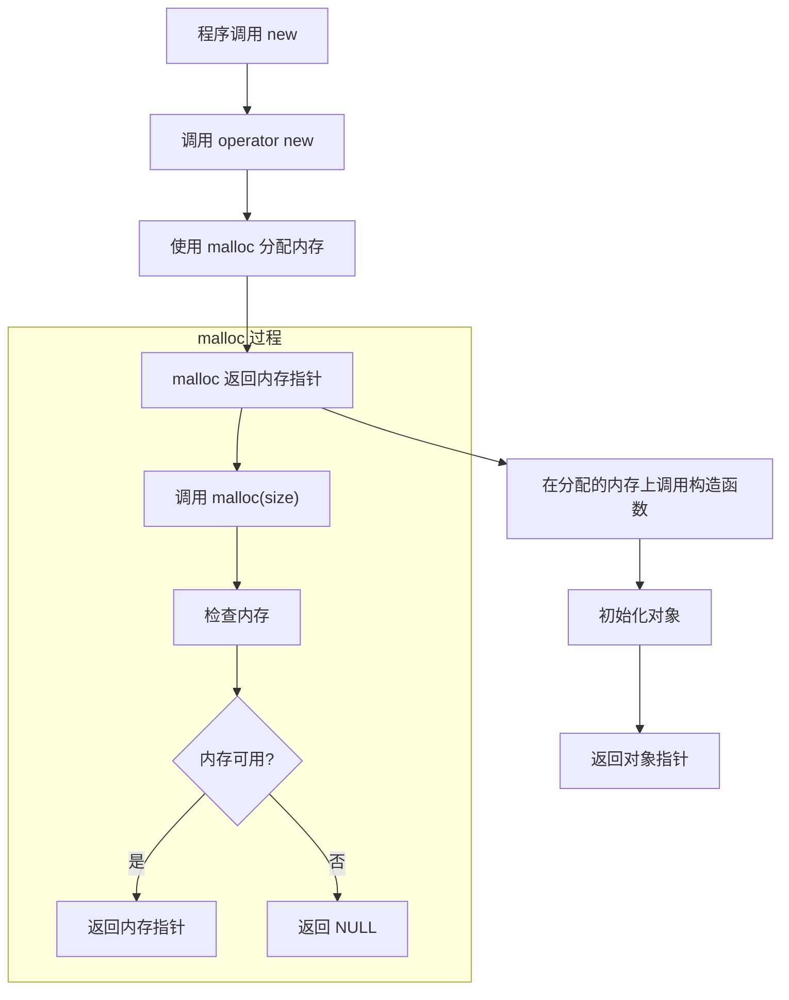
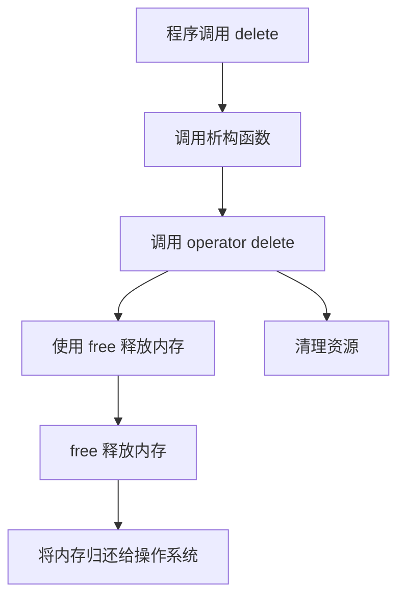
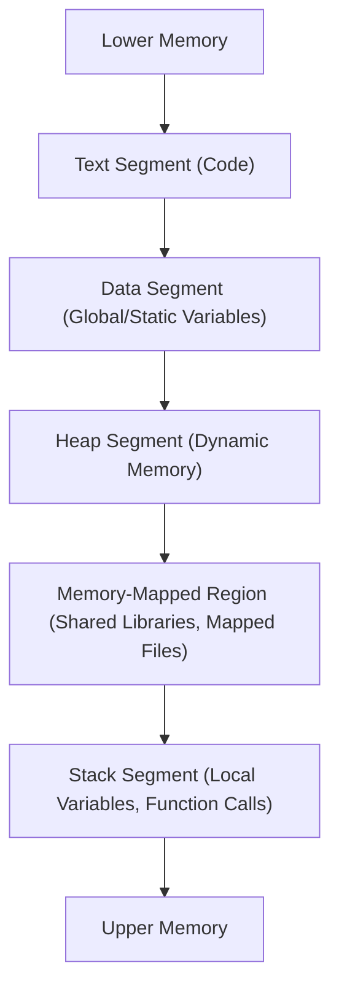

# 操作系统与 C++ 内存分配详解

本指南旨在系统性地整理关于操作系统和 C++ 内存分配的知识，帮助您全面理解内存管理的原理、机制和实践应用。内容涵盖了从基本概念到高级主题，包括内存池、堆段、虚拟内存、物理内存、页表、内存碎片、`malloc`、`new`、`brk`、`mmap` 等。

---

| 特性             | `malloc` / `free`   | `new` / `delete`           |
| ---------------- | ------------------- | -------------------------- |
| **内存分配**     | C 标准库函数        | C++ 运算符                 |
| **初始化**       | 不初始化            | 调用构造函数               |
| **返回类型**     | `void*`，需强制转换 | 类型安全，无需转换         |
| **分配失败处理** | 返回 `NULL`         | 抛出 `std::bad_alloc` 异常 |





## 1. 内存管理基础

### 1.1 内存的基本概念

- **内存**：计算机用于存储和访问数据的硬件资源，包括物理内存（RAM）和虚拟内存。
- **内存地址**：内存中的每个字节都有一个唯一的地址，用于定位和访问数据。

### 1.2 虚拟内存与物理内存

#### 虚拟内存

- **定义**：虚拟内存是每个进程拥有的独立地址空间，程序使用虚拟地址访问内存。
- **优点**：
  - 提供进程隔离，增强安全性和稳定性。
  - 支持内存管理技术，如分页和分段，优化内存使用。
  - 允许程序使用比实际物理内存更大的地址空间。

#### 物理内存

- **定义**：计算机实际安装的物理内存（RAM）。
- **特点**：
  - 速度快，但资源有限。
  - 被操作系统管理，多个进程共享物理内存。

#### 虚拟内存与物理内存的关系

- **地址转换**：虚拟地址通过内存管理单元（MMU）转换为物理地址。
- **分页机制**：虚拟内存被划分为固定大小的页（如 4KB），物理内存也划分为相同大小的页框（Frame）。
- **页面置换**：当物理内存不足时，操作系统可以将某些页面暂存到磁盘（交换区），实现内存的虚拟化。

### 1.3 进程的虚拟内存布局

每个进程的虚拟地址空间通常分为以下段：

1. **文本段（Text Segment）**：存储程序的可执行指令（机器代码），通常是只读的。
2. **数据段（Data Segment）**：
   - **已初始化数据段**：存储已初始化的全局变量和静态变量。
   - **未初始化数据段（BSS 段）**：存储未初始化的全局变量和静态变量，默认初始化为零。
3. **堆（Heap）**：用于动态内存分配，如通过 `malloc` 或 `new` 分配的内存，堆从低地址向高地址增长。
4. **栈（Stack）**：存储函数调用时的局部变量、函数参数和返回地址，栈从高地址向低地址增长。
5. **内核空间（Kernel Space）**：用于操作系统内核和驱动程序，不直接由用户程序访问。

#### 示例虚拟地址布局



## 2. 内存分配与释放机制

### 2.1 动态内存分配概述

- **动态内存分配**：在程序运行时根据需要分配和释放内存，提高内存使用的灵活性和效率。
- **常用函数**：
  - **C 语言**：`malloc`、`calloc`、`realloc`、`free`。
  - **C++ 语言**：`new`、`new[]`、`delete`、`delete[]`。

### 2.2 `malloc` 和 `free`

#### `malloc`

- **定义**：`malloc`（Memory Allocation）是 C 标准库中的函数，用于在堆上分配指定字节数的内存。
- **特点**：
  - 仅分配内存，不会初始化（内存内容不确定）。
  - 返回 `void*` 类型的指针，需要手动转换为相应类型。
  - 分配失败时返回 `NULL`。

#### `free`

- **定义**：`free` 用于释放通过 `malloc` 分配的内存。
- **特点**：
  - 释放内存后，该指针不再指向有效的内存区域，需要将指针置为 `NULL`，防止野指针。

#### 示例

```c
#include <stdlib.h>
#include <stdio.h>

int main() {
    int* arr = (int*)malloc(10 * sizeof(int)); // 分配 10 个整数的内存
    if (arr == NULL) {
        printf("Memory allocation failed\n");
        return 1;
    }

    // 使用内存
    for (int i = 0; i < 10; i++) {
        arr[i] = i;
    }

    free(arr); // 释放内存
    arr = NULL; // 防止野指针
    return 0;
}
```

### 2.3 `new` 和 `delete`

#### `new`

- **定义**：`new` 是 C++ 的运算符，用于在堆上分配内存并调用构造函数初始化对象。
- **特点**：
  - 自动进行类型推断，不需要强制类型转换。
  - 分配失败时抛出 `std::bad_alloc` 异常。

#### `delete`

- **定义**：`delete` 用于释放通过 `new` 分配的内存，并调用析构函数。
- **注意**：对于数组，需要使用 `delete[]`。

#### 示例

```cpp
#include <iostream>

int main() {
    int* p = new int(42); // 分配并初始化为 42
    std::cout << *p << std::endl;

    delete p; // 释放内存

    int* arr = new int[10]; // 分配数组
    delete[] arr; // 释放数组内存

    return 0;
}
```

### 2.4 `malloc` 与 `new` 的区别

| 特性         | `malloc` / `free`        | `new` / `delete`           |
| ------------ | ------------------------ | -------------------------- |
| 内存分配     | C 标准库函数             | C++ 运算符                 |
| 对象初始化   | 不调用构造函数/析构函数  | 调用构造函数/析构函数      |
| 返回类型     | `void*`，需要类型转换    | 类型安全，无需类型转换     |
| 分配失败处理 | 返回 `NULL`              | 抛出 `std::bad_alloc` 异常 |
| 用途         | 适用于 C 语言和 POD 类型 | 适用于 C++ 对象和类        |

### 2.5 内存分配的系统调用：`brk` 和 `mmap`

#### `brk` 和 `sbrk`

- **作用**：用于调整数据段（堆）的末端位置，改变进程的可用堆内存大小。
- **使用场景**：适合小块内存的动态增长和收缩。

#### `mmap`

- **作用**：用于内存映射文件或分配匿名内存，返回一段独立的虚拟内存区域。
- **使用场景**：适合大块内存的分配（通常 ≥ 128KB），避免堆碎片化。

---

## 3. 内存池与堆段

### 3.1 内存池的概念与作用

- **内存池（Memory Pool）**：一种内存管理技术，通过预先分配一大块内存，将其划分为多个固定大小的小块，以提高内存分配和释放的效率。
- **优点**：
  - 减少内存碎片。
  - 提高内存分配和释放的速度。
  - 降低系统调用的开销。

### 3.2 内存池与堆段的关系

- **堆段（Heap Segment）**：进程虚拟地址空间中的一部分，用于动态内存分配，由操作系统管理。
- **内存池的来源**：通常在堆段上创建，通过一次性调用 `malloc` 或 `new` 分配一大块内存。
- **管理层次**：
  - **堆段**：操作系统层面，提供基础的内存分配功能。
  - **内存池**：应用程序层面，提供特定场景下的高效内存管理。

### 3.3 内存池的实现与使用

- **实现方式**：

  - 预先分配一大块内存。
  - 将内存划分为固定大小的块。
  - 维护空闲块的列表，快速分配和释放。

- **适用场景**：
  - 需要频繁分配和释放相同大小的内存块。
  - 对性能有高要求的应用，如游戏开发、网络服务器等。

---

## 4. 内存碎片

### 4.1 内存碎片的类型与产生原因

- **内部碎片**：已分配内存块内部未使用的空间浪费，通常由于内存对齐或固定大小分配导致。
- **外部碎片**：在内存块之间未被分配但过于零散而无法有效利用的空间，通常由于频繁的分配和释放导致。

#### 产生原因

- **动态内存分配和释放**：频繁的分配和释放不同大小的内存块。
- **内存对齐**：为了满足硬件对齐要求，可能导致部分内存未被使用。
- **多线程竞争**：多线程环境下，不同线程的内存操作导致碎片化。

### 4.2 内存碎片的影响

- **降低内存利用率**：导致实际可用内存减少。
- **性能下降**：增加内存访问的开销。
- **程序崩溃**：在内存碎片严重时，可能无法分配足够大的连续内存块，导致程序异常退出。

### 4.3 减少内存碎片的技术

- **使用内存池**：预先分配并管理固定大小的内存块。
- **内存对齐技术**：使用合适的内存对齐方式，提高内存利用率。
- **使用 `mmap` 分配大块内存**：避免堆碎片化。
- **垃圾回收和内存压缩**：在支持垃圾回收的语言中，通过内存压缩减少碎片。
- **分级内存分配器（如 Slab Allocator）**：将内存分为不同大小的块，减少碎片。

---

## 5. 内存分配的底层原理

### 5.1 虚拟内存与物理内存的映射

- **地址转换**：虚拟地址通过页表和内存管理单元（MMU）转换为物理地址。
- **分页机制**：内存被划分为页（虚拟内存）和页框（物理内存），通常大小为 4KB。

### 5.2 页表与地址转换

- **页表（Page Table）**：用于存储虚拟页与物理页框的映射关系。
- **多级页表**：为减少页表占用的内存，采用多级结构，如二级或多级页表。
- **地址转换过程**：
  1. 将虚拟地址拆分为页号和页内偏移。
  2. 在页表中查找页号对应的物理页框号。
  3. 组合物理页框号和页内偏移，得到物理地址。

### 5.3 高地址与低地址的概念

- **高地址**：数值较大的地址，通常位于内存布局的顶部（如栈、内核空间）。
- **低地址**：数值较小的地址，通常位于内存布局的底部（如代码段、数据段）。

### 5.4 内存分配的方向

- **堆（Heap）**：从低地址向高地址增长。
- **栈（Stack）**：从高地址向低地址增长。

---

## 6. 内存分配器的优化

### 6.1 小内存块与大内存块的分配策略

- **小内存块（< 128KB）**：
  - 使用 `brk` 和 `sbrk` 调整堆空间。
  - 内存分配器维护空闲块的列表，提高分配效率。
- **大内存块（≥ 128KB）**：
  - 使用 `mmap` 分配独立的内存区域。
  - 释放时立即归还操作系统，减少碎片。

### 6.2 `malloc` 如何处理不同大小的内存分配

- **小内存分配**：
  - 使用 `arena` 和 `bins` 管理内存。
  - `arena`：为每个线程分配的内存区域，减少锁竞争。
  - `bins`：将小内存块分组，提高分配和释放效率。
- **大内存分配**：
  - 直接调用 `mmap` 分配内存。
  - 避免影响堆，减少碎片化。

### 6.3 内存对齐与效率

- **内存对齐**：将内存地址按特定字节边界对齐，提高内存访问效率。
- **对齐方式**：
  - 按 8 字节、16 字节、32 字节等对齐。
  - 对于对象或结构体，可能需要特定的对齐方式。

---

## 7. 实际应用与示例

### 7.1 `std::vector<int>` 的内存分配过程

- **初始化**：创建时，`vector` 的容量为 0，不分配内存。
- **添加元素**：
  - 如果容量不足，`vector` 会分配更大的内存块（通常是当前容量的两倍）。
  - 重新分配内存时，需要复制已有元素，并释放旧的内存。
- **释放内存**：
  - `vector` 超出作用域或被销毁时，自动调用析构函数，释放内存。

### 7.2 使用 `malloc` 的常见场景

- **动态数组**：根据运行时输入，分配可变大小的数组。
- **链表节点**：动态分配链表或树的节点。
- **二维数组**：分配动态大小的二维数组。
- **大块内存分配**：需要分配大缓冲区或缓存时。
- **与 C 语言兼容**：需要与 C 代码或库交互时。

### 7.3 `malloc` 与 `new` 的选择

- **使用 `new` 和 `delete`**：
  - 需要构造函数和析构函数。
  - 需要异常处理（`std::bad_alloc`）。
  - 更好的类型安全性。
- **使用 `malloc` 和 `free`**：
  - 与 C 代码兼容。
  - 不需要构造函数和析构函数。
  - 更底层的内存控制。

---

## 总结

通过对操作系统和 C++ 内存分配机制的深入探讨，我们了解了内存管理的各个方面，包括虚拟内存、物理内存、内存池、堆段、内存碎片、内存分配器的优化策略等。这些知识对于编写高效、稳定的程序至关重要。

在实际编程中，选择合适的内存分配方式和优化策略，可以显著提高程序的性能和可靠性。同时，理解底层原理也有助于我们在遇到内存相关问题时，能够快速定位和解决。

---

## 参考

- **C++ 标准库**：了解 `new`、`delete`、`malloc`、`free` 的用法。
- **操作系统原理**：深入理解虚拟内存、分页机制、系统调用等概念。
- **内存管理技术**：研究内存池、内存碎片的处理和优化策略。
- **多线程编程**：注意多线程环境下的内存管理和同步问题。

希望本指南能帮助您全面掌握操作系统和 C++ 内存分配的知识，助力您的学习和开发工作！

# 内存分配和释放的具体步骤解析

您提出了一个非常好的问题，希望深入了解内存分配和释放的具体一步一步过程。下面我将详细讲解内存分配和释放的全过程，包括从程序层面到操作系统和硬件层面的细节。我们将重点关注以下内容：

- **`malloc` 和 `free` 的内存分配与释放过程**
- **`new` 和 `delete` 的内存分配与释放过程**
- **内存分配器的工作机制**
- **操作系统如何管理内存**
- **虚拟内存到物理内存的映射**
- **系统调用如何参与内存管理**

---

## 1. `malloc` 和 `free` 的具体过程

### 1.1 `malloc` 的内存分配步骤

当您在程序中调用 `malloc` 函数时，内存分配过程包括以下步骤：

#### 步骤 1：调用 `malloc(size_t size)`

- **参数**：`size` 表示要分配的字节数。
- **目的**：请求分配一块指定大小的内存。

#### 步骤 2：检查参数有效性

- **内存分配器**会检查 `size` 是否为零或过大（超过可用内存）。
- 如果无效，`malloc` 返回 `NULL`。

#### 步骤 3：在内部数据结构中查找空闲块

- **内存分配器**维护着空闲内存块的数据结构，如自由链表（Free List）、二叉树或哈希表。
- **查找合适的空闲块**：
  - 根据 `size`，在空闲块中查找**最适合**的块（首次适应、最佳适应等算法）。
  - 如果找到合适的块，进入步骤 5。

#### 步骤 4：向操作系统请求更多内存（如需要）

- **情况**：如果没有找到合适的空闲块，需要从操作系统获取更多内存。
- **系统调用**：
  - **小块内存（通常 < 128KB）**：调用 `brk` 或 `sbrk` 调整数据段（堆）的末端，扩展堆空间。
  - **大块内存（通常 ≥ 128KB）**：调用 `mmap` 分配独立的内存区域。
- **更新内部数据结构**：将新获取的内存块加入空闲块列表。

#### 步骤 5：分割空闲块（如有必要）

- **如果空闲块大小大于请求的 `size`**，可能会将其分割成两部分：
  - 一部分分配给用户。
  - 另一部分留在空闲块列表中。

#### 步骤 6：更新内存分配器的数据结构

- 将分配给用户的内存块从空闲块列表中移除。
- 记录该内存块已被分配，防止重复分配。

#### 步骤 7：返回指向内存块的指针

- **返回值**：指向已分配内存块的指针（`void*` 类型）。
- **注意**：返回的内存块可能未初始化，需要程序员自行初始化。

### 1.2 `free` 的内存释放步骤

当您在程序中调用 `free` 函数时，内存释放过程包括以下步骤：

#### 步骤 1：调用 `free(void* ptr)`

- **参数**：`ptr` 是之前通过 `malloc` 分配的内存块的指针。
- **目的**：释放内存块，使其可供后续分配使用。

#### 步骤 2：检查指针有效性

- **内存分配器**会检查：
  - `ptr` 是否为 `NULL`，如果是，则不执行任何操作。
  - `ptr` 是否指向有效的内存块，防止非法释放或重复释放。

#### 步骤 3：将内存块标记为空闲

- **更新内存块的元数据**，标记为未分配状态。

#### 步骤 4：尝试合并相邻的空闲块（内存合并）

- **目的**：减少内存碎片，提高内存利用率。
- **合并策略**：
  - 检查内存块前后的邻居块是否也是空闲的。
  - 如果是，将它们合并成一个更大的空闲块。

#### 步骤 5：更新内存分配器的数据结构

- 将释放的内存块（或合并后的块）加入空闲块列表或其他管理结构中。

#### 步骤 6：可能的堆收缩（如需要）

- **条件**：如果释放的内存块位于堆的顶部（即堆的末端）。
- **操作**：调用 `brk` 或 `munmap` 将这部分内存归还给操作系统。
- **结果**：减少进程的虚拟内存占用。

---

## 2. `new` 和 `delete` 的具体过程

### 2.1 `new` 的内存分配与对象初始化

当您在 C++ 程序中使用 `new` 运算符时，过程如下：

#### 步骤 1：调用 `operator new(size_t size)`

- **参数**：`size` 是要分配的内存大小。
- **目的**：分配足够的内存来存储对象。

#### 步骤 2：内存分配

- `operator new` 通常调用 `malloc` 或自定义的内存分配器来分配内存。
- **与 `malloc` 的区别**：`operator new` 如果分配失败，默认会抛出 `std::bad_alloc` 异常，而不是返回 `NULL`。

#### 步骤 3：调用对象的构造函数

- **在已分配的内存上**，调用对象的构造函数，进行初始化。
- **构造函数**可能包含成员变量的初始化和其他自定义逻辑。

#### 步骤 4：返回指向对象的指针

- **返回值**：指向已初始化对象的指针。

### 2.2 `delete` 的内存释放与对象销毁

当您使用 `delete` 运算符释放对象时，过程如下：

#### 步骤 1：调用对象的析构函数

- **目的**：执行对象的清理工作，如释放资源、关闭文件等。
- **析构函数**在释放内存之前被调用。

#### 步骤 2：调用 `operator delete(void* ptr)`

- **参数**：`ptr` 是对象的指针。
- **目的**：释放内存块。

#### 步骤 3：内存释放

- `operator delete` 通常调用 `free` 或自定义的内存释放函数来释放内存。
- **与 `free` 的区别**：`operator delete` 不会返回值，也不需要检查指针有效性（假设调用者保证）。

---

## 3. 内存分配器的工作机制

### 3.1 内存分配器的数据结构

内存分配器需要高效地管理已分配和空闲的内存块，常用的数据结构包括：

- **自由链表（Free List）**：
  - 维护空闲内存块的链表。
  - 可以是单链表或双链表。
- **分离空闲链表（Segregated Free Lists）**：
  - 根据内存块大小，将空闲块分成不同的链表。
  - 提高查找效率，适合不同大小的内存请求。
- **二叉树或平衡树**：
  - 用于快速查找合适大小的空闲块。
- **位图（Bitmap）**：
  - 用位表示内存块的使用情况。

### 3.2 内存分配策略

- **首次适应（First Fit）**：
  - 从头开始查找，找到第一个足够大的空闲块。
- **最佳适应（Best Fit）**：
  - 查找所有空闲块，找到大小最接近的。
- **最差适应（Worst Fit）**：
  - 选择最大的空闲块，以减少碎片。
- **伙伴系统（Buddy System）**：
  - 内存块大小为 2 的幂，方便合并和分割。

### 3.3 内存释放与碎片管理

- **合并空闲块**：
  - 当释放内存块时，尝试合并相邻的空闲块。
- **分割空闲块**：
  - 当空闲块过大时，分割成更小的块，减少内部碎片。
- **内存碎片**：
  - **内部碎片**：已分配内存块内部未使用的空间。
  - **外部碎片**：空闲内存块之间的零散空间，无法满足较大内存请求。

---

## 4. 操作系统的内存管理

### 4.1 虚拟内存与物理内存

- **虚拟内存**：进程看到的内存地址空间，由操作系统提供的抽象。
- **物理内存**：实际的 RAM，有限的资源，由多个进程共享。
- **目的**：通过虚拟内存机制，提供进程隔离和更大的地址空间。

### 4.2 页表与地址转换

- **分页机制**：
  - 虚拟内存被划分为固定大小的页（如 4KB）。
  - 物理内存被划分为相同大小的帧（Frame）。
- **页表（Page Table）**：
  - 存储虚拟页与物理帧的映射关系。
  - 每个进程有自己的页表。
- **地址转换过程**：
  1. **虚拟地址分解**：将虚拟地址拆分为页号和页内偏移量。
  2. **查找页表**：通过页号找到对应的物理帧号。
  3. **生成物理地址**：将物理帧号与页内偏移量组合，得到物理地址。

### 4.3 系统调用 `brk` 和 `mmap` 的作用

#### `brk` 和 `sbrk`

- **功能**：调整数据段（堆）的末端位置，改变进程的堆大小。
- **使用场景**：适合小块内存的动态增长和收缩。

#### `mmap`

- **功能**：将文件或匿名内存映射到进程的虚拟地址空间。
- **使用场景**：分配大块内存，避免堆碎片。
- **优势**：分配的内存独立于堆，可独立释放。

---

## 5. 综合示例：内存分配的全过程

### 5.1 分配小内存块的过程

假设程序调用 `malloc(64)` 分配 64 字节的内存，以下是详细步骤：

#### 步骤 1：程序调用 `malloc(64)`

- 请求分配 64 字节的内存。

#### 步骤 2：内存分配器查找空闲块

- 在对应的 **bin**（管理相同大小内存块的列表）中查找。
- 如果 **bin** 中有空闲块，直接分配（进入步骤 5）。
- 如果没有，进入步骤 3。

#### 步骤 3：需要从堆中分配新的内存块

- **内存分配器**调用 `brk` 或 `sbrk` 扩展堆空间，例如扩展 4KB。

#### 步骤 4：更新内存分配器的数据结构

- 将新扩展的内存划分为多个 64 字节的块。
- 将这些块加入对应的 **bin**。

#### 步骤 5：从 **bin** 中分配内存块

- 从 **bin** 中取出一个 64 字节的内存块。
- 更新 **bin** 的状态。

#### 步骤 6：返回指向内存块的指针

- 程序获得分配的内存块，可以开始使用。

### 5.2 分配大内存块的过程

假设程序调用 `malloc(200 * 1024)` 分配 200KB 的内存，以下是详细步骤：

#### 步骤 1：程序调用 `malloc(200 * 1024)`

- 请求分配 200KB 的内存。

#### 步骤 2：内存分配器判断为大块内存

- 由于请求的大小超过 128KB，认为是大块内存。

#### 步骤 3：调用 `mmap` 分配内存

- **内存分配器**调用 `mmap`，请求操作系统分配 200KB 的匿名内存区域。

#### 步骤 4：操作系统分配内存

- 在进程的虚拟地址空间中创建一个新的内存映射。
- 更新页表，映射虚拟页到物理帧。

#### 步骤 5：返回指向内存块的指针

- 程序获得分配的内存块，可以开始使用。

#### 步骤 6：释放内存时调用 `munmap`

- 当程序调用 `free` 释放内存时，内存分配器调用 `munmap`，将内存归还给操作系统。

---

## 6. 总结

通过上述详细的步骤，我们了解了内存分配和释放的具体过程，包括：

- **`malloc` 和 `free`**：如何在内存分配器的支持下，分配和释放内存，包括内部的数据结构和算法。
- **`new` 和 `delete`**：如何结合对象的构造和析构，实现内存管理和对象生命周期的管理。
- **内存分配器**：维护空闲块的数据结构，采用不同的策略优化内存分配和释放。
- **操作系统的支持**：通过系统调用 `brk` 和 `mmap`，提供底层的内存管理功能。
- **虚拟内存机制**：通过页表和地址转换，实现虚拟地址到物理地址的映射，支持进程的内存需求。
